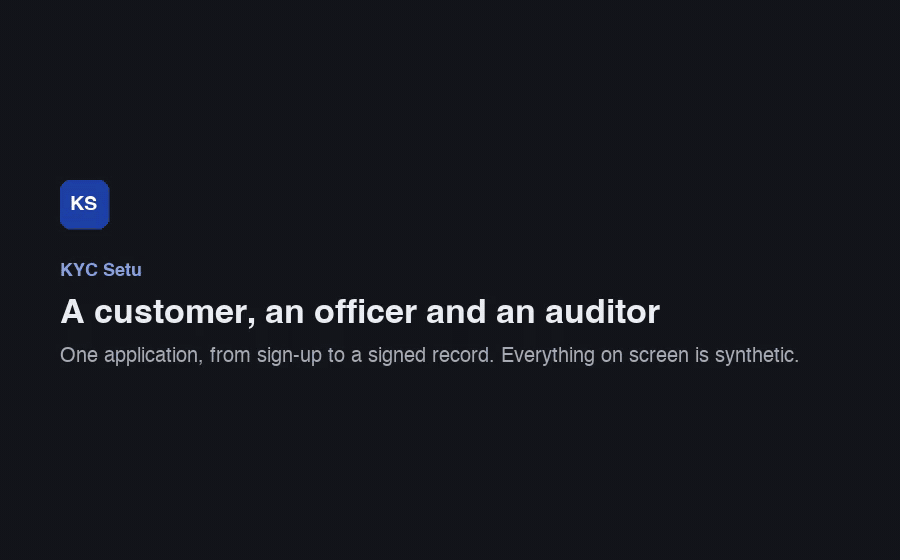

# KYC Setu

> A KYC-style identity-verification workflow for Indian banks and fintechs, built end to end as a portfolio project. **Not a
> licensed KYC provider, not a compliance product; everything in it is synthetic.**

_Setu_ is Hindi for "bridge". **KYC Setu lets a customer complete identity verification on their phone (consent, details, PAN
and Aadhaar, signature), reads the documents with OCR, scores the application with explainable rules, and puts it in front of a
bank officer who approves, rejects or sends it back; an auditor can check afterwards that nothing was changed.** It is for
anyone who wants to see what a careful implementation of that workflow looks like: encrypted documents, a state machine
you can read, an audit log you can verify, and honest notes on what is missing.

What is realistic: the architecture, the encryption, the permission model, the review workflow and the audit trail are built
the way a real system would need them. What is deliberately simulated: the **selfie, face match and liveness step is not built**
(a development endpoint records the signals it would), the mobile OTP is shown on screen instead of sent, notifications are log
lines, and the key-management service and signing key are development stand-ins. All people, documents, PANs and Aadhaar
numbers are invented and visibly fake. [The full list is below.](#what-is-real-and-what-is-simulated)

## See it work



About 70 seconds, recorded by a script ([`apps/web/e2e/demo`](apps/web/e2e/demo/full-flow.spec.ts)) against the real stack: a
customer signs up and uploads four documents; the OCR service reads them; an officer reviews the evidence and the risk
breakdown and approves; the customer's screen says so; an auditor verifies the audit chain. (The selfie step is shown as what it
is, not built: the recording says where a development endpoint stands in.) A [hand-drawn architecture picture](docs/media/architecture.svg)
is in `docs/media`.

## Run it

You need Docker, Node 22+, [pnpm](https://pnpm.io) and [uv](https://docs.astral.sh/uv/).

```bash
git clone https://github.com/Lakshyalamba/kyc_setu.git && cd kyc_setu
cp .env.example .env     # the local defaults work as they are
make up                  # Postgres, Redis, MinIO in Docker (and a development signing key)
pnpm install
pnpm db:migrate
(cd services/ai && uv sync)
pnpm seed                # asks before wiping the local stack; add --yes to skip the question
pnpm dev:ai              # in a second terminal: the OCR service on :8000 (the first start loads models)
pnpm dev                 # web :3000, API :4000 and the queue worker
# then open http://localhost:3000. The logins print at the end of `pnpm seed`.
```

Nothing to install for OCR? Set `AI_SERVICE_URL=http://localhost:4000/dev/ai-mock` in `.env` and skip `pnpm dev:ai`: the API
serves a stand-in that answers with canned readings.

The seed leaves you with these (all passwords are `password123`; staff sign in at `/officer/login`, customers at `/login`):

| Login                                                              | Role / state                                                           |
| ------------------------------------------------------------------ | ---------------------------------------------------------------------- |
| `lead@kycsetu.dev`                                                 | Officer lead: reviews, unlocks accounts, runs the retention dry run    |
| `priya.officer@kycsetu.dev`, `arjun.officer@kycsetu.dev`           | Officers: claim from the queue, review, decide                         |
| `auditor@kycsetu.dev`                                              | Auditor: read-only; verifies the audit chain, exports a signed packet  |
| `customer1@kycsetu.dev`                                            | Just signed up; no application yet                                     |
| `customer2@kycsetu.dev`                                            | `DRAFT`: mobile verified, consent accepted                             |
| `customer3@kycsetu.dev`                                            | `DOCS_UPLOADED`: OCR still pending; run `pnpm dev` and watch it finish |
| `customer4@kycsetu.dev`                                            | Under review, **LOW** risk, all clean: the one to approve              |
| `customer5@kycsetu.dev`                                            | Under review, **MEDIUM**: the typed name differs from both cards       |
| `customer6@kycsetu.dev`                                            | Under review, **HIGH**: a different face on the cards, liveness failed |
| `history.approved1@…`, `history.approved2@…`, `history.rejected@…` | Earlier decisions, for the auditor's search and the duplicate rules    |

Every PAN in the seed starts `TEST` and every Aadhaar number starts `9999 0000`: invented, checksum-valid, nobody's.
More: [ports, commands and every environment variable](docs/configuration.md).

## How it fits together

```
  customer ──┐                                   enqueue                take                POST /extract
  (phone)    │   ┌─────────┐  JSON + cookie  ┌──────────┐  ───▶  ┌──────────────┐  ───▶  ┌──────────┐  ───▶  ┌───────────────────┐
             ├─▶ │   web   │ ──────────────▶ │   API    │        │ Redis/BullMQ │        │  worker  │        │   AI service      │
  officer ───┤   │ Next.js │ ◀────────────── │ Express  │        └──────────────┘        │ OCR calls│  ◀───  │ FastAPI+PaddleOCR │
             │   └─────────┘   review page,  │ zod, RBAC│                                │ risk,    │ fields │ stateless: no DB, │
  auditor ───┘                 audit console └────┬─────┘                                │ audit job│ + conf.│ no keys           │
                                                  │                                      └────┬─────┘        └───────────────────┘
                                         reads and writes                                writes results
                                                  ▼                                         ▼
                                   ┌────────────────────────────────────────────────────────────────┐
                                   │  Postgres: state machine, decisions, audit log + hash chain    │
                                   │  MinIO / S3: documents, each encrypted with its own key        │
                                   └────────────────────────────────────────────────────────────────┘
```

The request to the AI service carries a 60-second signed link; the service pulls that one document back through the API, so it
never holds storage credentials or keys.

Only the API and the worker write to the database; the AI service is a function: a document in, fields and confidences out.
[architecture.md](docs/architecture.md) explains why it is split this way, why a queue, why envelope encryption, why PaddleOCR,
what was weighed and left out, and what would break first at ten times the load.

An application moves through a state machine whose every edge is a row in a table, with a guard, an actor and a test:

```mermaid
stateDiagram-v2
    [*] --> DRAFT
    DRAFT --> CONSENT_GIVEN
    CONSENT_GIVEN --> PERSONAL_SUBMITTED
    PERSONAL_SUBMITTED --> DOCS_UPLOADED
    DOCS_UPLOADED --> DOCS_EXTRACTED: worker reads the documents
    DOCS_EXTRACTED --> SELFIE_CAPTURED: not built; a dev endpoint stands in
    SELFIE_CAPTURED --> SUBMITTED: risk assessed
    SUBMITTED --> UNDER_REVIEW
    UNDER_REVIEW --> APPROVED
    UNDER_REVIEW --> REJECTED
    UNDER_REVIEW --> RESUBMIT_REQUESTED
    RESUBMIT_REQUESTED --> DOCS_UPLOADED
```



[state-machine.md](docs/state-machine.md) has the full table, including expiry.

## What's inside

Nine phases (0 to 8). **Phase 4 is not in this repository.**

- **Phase 0, foundations.** pnpm monorepo, Docker Compose infrastructure, Express and BullMQ, Prisma, typed config, an
  append-only audit log, CI. → [configuration](docs/configuration.md), [data model](docs/data-model.md)
- **Phase 1, the customer's journey.** Sign-up, mobile OTP, versioned consent, personal details with autosave, a 24-hour
  session. → [KYC flow](docs/features.md#kyc-flow-phase-1)
- **Phase 2, documents.** Streaming upload, type sniffing, per-file AES-256-GCM envelope encryption, short-lived signed links,
  a signature pad that works with a finger. → [Documents](docs/features.md#documents-phase-2)
- **Phase 3, OCR.** A stateless FastAPI service running PaddleOCR (English and Hindi), parsers for PAN and Aadhaar with
  checksums, confidences and boxes; a worker with retries. → [OCR extraction](docs/features.md#ocr-extraction-phase-3)
- **Phase 4, selfie, face match, liveness: not built.** The risk engine and the review page already consume their results through
  a defined interface; a development endpoint injects them. See [what is not built](#intentionally-not-built).
- **Phase 5, risk.** Seventeen named rules, weights, bands and floors in one file; deterministic, versioned, explainable.
  → [risk engine](docs/risk-engine.md)
- **Phase 6, the officer's side.** A queue ordered by risk, a one-request review page with every piece of evidence and its
  box on the image, soft claims, audited Aadhaar reveal, approve / reject / send back, and the customer's screens follow.
  → [Officer review](docs/features.md#officer-review-phase-6)
- **Phase 7, trust.** A permissions matrix and one guard, masking in one function, an append-only audit log with a daily hash
  chain, immutable consent text, rate limits and lockout, signed audit packets, retention policy, an auditor console.
  → [Audit integrity](docs/features.md#audit-integrity-and-access-control-phase-7), [security](docs/security.md)
- **Phase 8, polish.** The demo seed, OpenAPI, structured logs and metrics, coverage gates, recorded browser journeys, a load
  smoke, dark mode that passes AA, CI, and the documents you are reading. → [API](docs/api.md), [testing](docs/testing.md),
  [performance](docs/performance.md)

## Access control

Routes ask for a **permission**, never a role. The table is data ([`permissions.ts`](packages/shared/src/rbac/permissions.ts));
a denial is a 403 that names the missing permission and is audited; a test runs every guarded route as every role.

| Permission               | Customer | Officer | Lead | Auditor | What it covers                                 |
| ------------------------ | :------: | :-----: | :--: | :-----: | ---------------------------------------------- |
| `kyc.session.read.own`   |    ✓     |         |      |         | their own application, documents, status, slip |
| `kyc.session.read.any`   |          |    ✓    |  ✓   |    ✓    | the queue and the review page (always masked)  |
| `kyc.session.claim`      |          |    ✓    |  ✓   |         | claim, release, take over                      |
| `kyc.session.decide`     |          |    ✓    |  ✓   |         | approve, reject, send back; recompute risk     |
| `kyc.session.reveal_pii` |          |    ✓    |  ✓   |         | the audited full-Aadhaar reveal                |
| `audit.read`             |          |         |  ✓   |    ✓    | verify the chain, search every application     |
| `audit.export`           |          |         |  ✓   |    ✓    | build a signed packet for one application      |
| `officer.manage`         |          |         |  ✓   |         | unlock an account; retention dry run           |

## What is real and what is simulated

| Real                                                                          | Simulated or a stand-in                                                              |
| ----------------------------------------------------------------------------- | ------------------------------------------------------------------------------------ |
| Sign-in, sessions, roles, lockout, rate limits                                | **Selfie, face match, liveness**: a development endpoint injects the signals         |
| Encrypted uploads, per-file keys, signed expiring links                       | Mobile OTP: shown on screen outside production; no SMS provider                      |
| OCR with the real PaddleOCR models on the synthetic cards                     | E-mail and notifications: a log line and an audit row                                |
| Cross-document validation and the risk rules                                  | KMS: a master key from an environment variable; the AWS client is a stub             |
| The review workflow, the decision snapshot, the customer's follow-up          | The audit-packet signing key: a file in `infra/dev-keys/`                            |
| The append-only audit log, the hash chain, signed packets that verify offline | Retention: written down and dry-run only; nothing is purged                          |
| Metrics, structured logs, readiness, an OpenAPI reference                     | The load test: the OCR service is mocked, to measure the pipeline and not the models |
| Tests: 800+, coverage gates, 27 recorded browser specs, a load smoke          | All people, documents and numbers                                                    |

## Working on it

```bash
make verify          # the pre-push gauntlet: install, prisma validate, typecheck, lint, every test with coverage gates, build
pnpm test:e2e:ci     # Docker Compose stack, seed, all browser specs headless with video -> test-artifacts/
pnpm load:smoke      # 50 customers, 10 at a time, with budgets
pnpm demo:record     # re-record docs/media/full-flow.gif
```

The same steps run in CI: [`pr.yml`](.github/workflows/pr.yml) on every pull request, [`nightly.yml`](.github/workflows/nightly.yml)
for the slow ones (it has not yet run on a GitHub runner). Coverage today: API 92%, risk engine 98%, shared 82%, OCR parsers 96%
(gates at 80, 80, 80 and 70). Load smoke on the author's laptop, OCR mocked: P95 of `personal/submit` 135 ms, a 5 MB upload
541 ms, a risk-engine run 0.02 ms; see [performance.md](docs/performance.md) for what that does and does not say.
API reference: run the stack and open <http://localhost:4000/docs>. Where to start reading the code:
[architecture.md](docs/architecture.md), then [`packages/shared/src/kyc-state.ts`](packages/shared/src/kyc-state.ts) (the state
machine), [`packages/risk/src/config.ts`](packages/risk/src/config.ts) (every number the risk engine uses) and
[`apps/api/src/app.ts`](apps/api/src/app.ts) (how the API is assembled).

## Intentionally not built

| Not built                                             | Why                                                                                                                                                                                                                           |
| ----------------------------------------------------- | ----------------------------------------------------------------------------------------------------------------------------------------------------------------------------------------------------------------------------- |
| **Selfie capture, face match and liveness (Phase 4)** | Not finished, and the one real gap: everything downstream is built and tested around it, and a development endpoint stands in. Real liveness is hard to build and harder to trust, and needs data this project does not have. |
| Video KYC                                             | A different product: a scheduled call with an agent, recording and its own retention rules                                                                                                                                    |
| DigiLocker and Aadhaar offline eKYC                   | They need registration with, and credentials from, the issuing authorities, which a portfolio project cannot have                                                                                                             |
| AML and sanctions screening                           | Needs licensed watchlist data and a case-management process; out of scope of identity verification                                                                                                                            |
| Production-grade liveness and deepfake resistance     | See Phase 4                                                                                                                                                                                                                   |
| Multi-tenancy                                         | One bank, one deployment. Row-level isolation per tenant would touch every table and every test, and teaches nothing the rest does not                                                                                        |
| Real e-mail and SMS                                   | Needs provider accounts and templates; the seams (`notify`, the OTP sender) are single functions                                                                                                                              |
| A real KMS, an HSM and key rotation                   | The interfaces are there; see [security.md](docs/security.md)                                                                                                                                                                 |
| Anything that claims compliance with a regulation     | It would be untrue. This is a **KYC-style workflow**; whether a real deployment satisfies any rule is for that bank to establish                                                                                              |

The honest list of security gaps is in [security.md](docs/security.md#not-built-on-purpose-or-not-yet).

## Credits and licences

This project stands on others' work. What it actually uses:

| Component                                                                                                                                        | Used for                                                 | Licence             |
| ------------------------------------------------------------------------------------------------------------------------------------------------ | -------------------------------------------------------- | ------------------- |
| [PaddleOCR](https://github.com/PaddlePaddle/PaddleOCR) / PaddlePaddle                                                                            | Text detection and recognition (English, Hindi)          | Apache-2.0          |
| [OpenCV](https://opencv.org)                                                                                                                     | Image decoding, quality checks                           | Apache-2.0          |
| [pypdfium2](https://github.com/pypdfium2-team/pypdfium2)                                                                                         | Rendering PDF pages (chosen over PyMuPDF, which is AGPL) | Apache-2.0 / BSD-3  |
| [Prisma](https://www.prisma.io)                                                                                                                  | Database access and migrations                           | Apache-2.0          |
| [Next.js](https://nextjs.org), [Express](https://expressjs.com), [zod](https://zod.dev), [BullMQ](https://bullmq.io), [pino](https://getpino.io) | The application                                          | MIT                 |
| [FastAPI](https://fastapi.tiangolo.com), [structlog](https://www.structlog.org)                                                                  | The AI service                                           | MIT, MIT/Apache-2.0 |
| [Scalar](https://scalar.com)                                                                                                                     | The API reference viewer                                 | MIT                 |
| [Playwright](https://playwright.dev)                                                                                                             | Browser tests and the recorded demo                      | Apache-2.0          |
| [Mermaid](https://mermaid.js.org)                                                                                                                | Diagrams in the documentation                            | MIT                 |

**insightface and RetinaFace** were planned for the face-match phase and **are not used**, since that phase is not built. If it
is built: the insightface code is MIT, but its published pretrained model packs are licensed for non-commercial research use,
which would matter for anything a bank deploys. Check before adopting them.

The sample documents and faces are drawn by [`scripts/sample-docs/make_samples.py`](scripts/sample-docs/make_samples.py) with
Pillow: invented people, invented numbers, three cartoon avatars, every card stamped "SAMPLE DOCUMENT - NOT REAL". No real
person's photograph or number is anywhere in this repository.

**Licence of this repository:** none has been chosen yet, so by default all rights are reserved by the author. Add a `LICENSE`
file before reusing the code.

## Disclaimer

KYC Setu is a demonstration of how a KYC-style workflow can be built. It is not a licensed or regulated KYC service, it has
not been audited or penetration-tested, and nothing in it is legal, compliance or security advice or a claim that it satisfies any law,
regulation or standard. Do not use it with real people's identity documents. (This wording is mine: the roadmap's own risk
section was not available when the README was written, so replace it with that text if it differs.)
