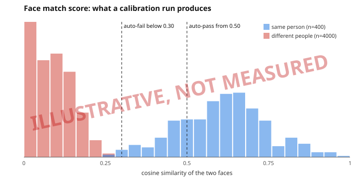
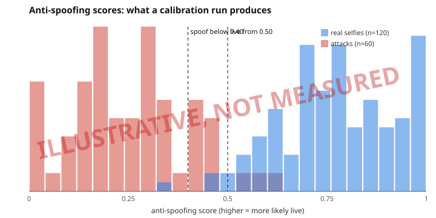

# Face-match calibration

**Status: the thresholds are not calibrated on real faces.** This page says what they are, why they are what they are, what
has and has not been measured, and how to measure them properly. If you read one sentence: do not treat `0.30` and `0.50` as
a decision a bank can defend until someone has run the script below on real, consented photographs.

## What the score is

The AI service embeds the face on the Aadhaar front and the face in the selfie (SFace, a 128-number vector each) and returns
their **cosine similarity**, clamped to 0..1 (`max(0, cosine)`). It does not rescale with `(cosine + 1) / 2`, which would put
two unrelated faces near 0.5 and make a threshold mean something it does not. The service returns the score and the evidence;
the API's worker turns the score into a decision with [`packages/shared/src/face/thresholds.ts`](../packages/shared/src/face/thresholds.ts),
the only place a face number lives.

| Score           | Decision    | What happens                                                                  |
| --------------- | ----------- | ----------------------------------------------------------------------------- |
| 0.50 and above  | `AUTO_PASS` | nothing extra: the officer still reviews every application                    |
| 0.30 up to 0.50 | `REVIEW`    | the risk engine adds `face-match-borderline` (15 points)                      |
| below 0.30      | `AUTO_FAIL` | `face-match-below-threshold` (35 points, band floor HIGH); one retake offered |

## Where 0.30 and 0.50 came from

SFace's own paper and model card put its same-person operating point at a cosine of about **0.363**. The thresholds are set
either side of it: 0.30 is a little below, so that a clearly different person fails and a degraded genuine match does not; 0.50
is comfortably above, so that "pass" means a face that looks like the ID's. That is reasoning from a published number, not
measurement. A printed Aadhaar photo is small, dithered and often years old, which pulls genuine scores **down**; a
selfie under a ceiling light does the same. Both thresholds may be too high for real use, and the first symptom would be
honest customers landing in `REVIEW` (which costs officer time, not safety).

## What has been measured here

Nothing on real faces. The test suite runs the real models on the synthetic cartoon avatars in `scripts/sample-docs/avatars`.
The detector finds those faces, so the plumbing is exercised end to end, but the embedding does not separate cartoons:
different avatars score 0.4 to 0.8 against each other. Those numbers say nothing about people, and the repository holds no
photographs of real people, on purpose. The end-to-end browser runs use a stand-in service that looks at no pixels (see
`AI_FACE_BACKEND=stub` in [services/ai/README.md](../services/ai/README.md)).

## How to measure it

Collect photographs of people who agreed to it: at least 30 people with 3 or more photos each, taken like the real inputs
(a phone picture of a printed ID card, and selfies in ordinary light), kept **outside** the repository, with one folder per
person:

```
~/calibration-photos/asha/id-card.jpg
~/calibration-photos/asha/selfie-1.jpg
~/calibration-photos/ravi/id-card.jpg   ...
```

Run the AI service allowed to fetch from the script's local server, then the script:

```bash
AI_FETCH_ALLOWED_ORIGINS=http://localhost:4999 pnpm dev:ai
```

```bash
pnpm calibrate:faces --dir ~/calibration-photos --out docs/media/face-score-histogram.svg
```

It scores every same-person pair and every different-person pair, prints their distributions, shows how many of each the
thresholds in force would pass or fail, and says what the data would justify for a target of at most 0.1% of different-person
pairs auto-passing and at most 1% of same-person pairs auto-failing. With fewer than about 1,000 different-person pairs and
100 same-person pairs it declines to suggest anything: a 0.1% rate cannot be read from a few dozen pairs.



**That chart is illustrative.** It is drawn from made-up scores (`pnpm calibrate:faces --demo`) and is stamped as such in the
image. It shows what the output looks like, nothing about this model.

## Liveness calibration

The face thresholds above are about whether two faces are the same person. This section is about whether the face in front of
the camera is a live one, which is what the passive anti-spoofing model ([services/ai/README.md](../services/ai/README.md#passive-anti-spoofing-pad-behind-the-motion-check))
tries to tell. **No real number exists yet.** The table at the end is empty on purpose; until a row is filled in from
`pnpm calibrate:liveness` on a real set, there is no measured error rate, and nothing in this repository supports switching
`LIVENESS_METHOD` away from its default of `MOTION_CHECK`.

### Method

The terms are ISO/IEC 30107-3's:

- **APCER**, attack presentation classification error rate: the share of attacks the model accepts as live. The dangerous error.
- **BPCER**, bona fide presentation classification error rate: the share of real selfies it turns away. The annoying one.

Judged per kind of attack and by the worst kind, because an average hides a hole: a model that stops every print and no screen
replay has a fine average and a useless worst case.

**The dataset.** Local only, never committed (`liveness-photos/` is git-ignored):

```
~/liveness-photos/bonafide/*.jpg            real selfies, taken by real people who agreed, with the cameras you expect
~/liveness-photos/attacks/print/*.jpg       a selfie printed on paper and photographed
~/liveness-photos/attacks/screen-replay/*.jpg   a selfie shown on another phone's screen and photographed
```

Every picture must be a photograph taken with a camera of what it is labelled as: an attack is a picture of a print or a screen,
not the selfie file itself. Aim for at least 20 attacks per kind and 100 real selfies. The script sends each picture alone (the
motion check cannot be evaluated on a still) and reads only the anti-spoofing score.

```bash
AI_FETCH_ALLOWED_ORIGINS=http://localhost:4999 pnpm dev:ai
```

```bash
pnpm calibrate:liveness --dir ~/liveness-photos --out docs/media/liveness-score-histogram.svg
```

It prints APCER and BPCER at the two thresholds in force and across a sweep, APCER per kind of attack, the lowest threshold that
reaches 15% overall APCER, and the gate below.



**That chart is illustrative**, drawn from made-up scores (`pnpm calibrate:liveness --demo`) and stamped as such in the image.

### Which threshold is the real one

The decision has three bands: **live** from 0.50, **borderline** from 0.40 up to 0.50, **spoof** below 0.40. A borderline selfie
_passes_ (and the risk engine adds `liveness-pad-borderline`, 10 points, so an officer looks). So the line between "let through"
and "stopped" is **0.40**, not 0.50, and APCER must be read there. The script reports both and judges the gate at 0.40. A
picture with no usable face is rejected: it counts against the model for real selfies and in its favour for attacks.

### The gate

If the worst-kind APCER at 0.40 is above about **15%** on your set, do not switch the default: stay on `MOTION_CHECK`, keep
recording the model in shadow, and write the finding here. The point is an honest number, not a good one.

### What this cannot tell you

- Whether the number holds on other cameras, lighting, phones and people. A few dozen pictures from one phone say little about
  a population, and a model can fail more often for some faces than others; this method measures none of that.
- Anything about masks, replays injected into the camera feed, or deepfakes. None of those are in the attack set, and the model
  was not built or tested against them.
- Anything about the model's training data, which its publisher does not disclose.
- A certification. This is not iBeta/NIST testing and must not be described as it.

### Results

| Date     | Set (people / real selfies / attacks per kind) | Camera(s) | APCER at 0.40, worst kind | BPCER at 0.40 | Decision                     |
| -------- | ---------------------------------------------- | --------- | ------------------------- | ------------- | ---------------------------- |
| none yet |                                                |           |                           |               | default stays `MOTION_CHECK` |

When a row exists, the sentence that goes with it is: "On a tiny local set, APCER was X%, BPCER was Y%; this is not certified
anti-spoofing and should not be used as the sole liveness check in a regulated deployment."

## When you change a threshold

It is a policy decision, not a tuning knob. Change `FACE_MATCH_THRESHOLDS`, update the table above and the snapshots, and
bump the risk engine version (`packages/risk/src/version.ts`), because the same application would now be assessed differently.
Old assessments keep their own recorded threshold: every face match stores the thresholds in force when it was made.

## What this does not cover

Fairness. A face model's error rates differ across skin tones, ages and genders, and a single threshold hides that. A real
calibration reports error rates per group, which needs a dataset labelled for it and a decision about what difference is
acceptable. This repository has neither.
