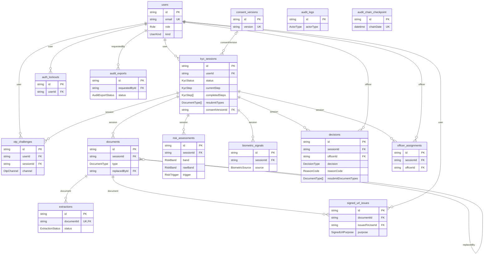

# Data model

Postgres, through Prisma ([`packages/db/prisma/schema.prisma`](../packages/db/prisma/schema.prisma), 15 tables, 11 hand-written
migrations in `packages/db/prisma/migrations/`). This page is the map; the schema file has a comment on every table
that is not obvious. The diagram below is **generated from the schema** (`pnpm docs:erd`) and a test fails if it is stale.

## The diagram

Keys and the enum columns that drive behaviour only; the other columns are in the table notes further down. Two tables have no
lines on purpose: `audit_logs.actorId` is not a foreign key (the log has to survive a deleted user and record failed
sign-ins for people who do not exist), and `audit_chain_checkpoint` is derived from `audit_logs` by date, not by key.

<!-- erd:start -->



<!-- erd:end -->

## Three rules that shape everything

1. **Nothing is deleted.** Every foreign key is `ON DELETE RESTRICT`. A removed document is a row that points at itself, a
   replaced one points at its replacement, and the ciphertext stays. History is something you query, not something you
   reconstruct.
2. **What was decided is never rewritten.** `decisions`, `risk_assessments`, `audit_logs`, `audit_chain_checkpoint` and
   published `consent_versions` have triggers that reject `UPDATE` and `DELETE` (consent rows may only gain a
   `supersededAt`). `TRUNCATE` is deliberately not blocked, which is what `pnpm seed` and the test cleanup use. A superuser
   can switch a trigger off; the hash chain exists so that is noticed ([security.md](security.md)).
3. **Rules the database can enforce, it enforces.** Prisma cannot express partial unique indexes or `CHECK` constraints, so
   they live in the migration SQL: one active session per customer, one current document per type per session, one
   active reviewer per session, and "a REJECT or REQUEST_RESUBMIT decision has a reason code, an APPROVE has none".

## Tables

PII column: **high** = holds or can reveal an identity document or a typed identifier; **low** = identifiers and metadata
only; **none** = nothing about a person. Retention periods are those of [retention-policy.md](retention-policy.md); nothing is purged yet.

### Identity and access

| Table           | What a row is                                                                 | PII | Notes                                                                                                                                                                        |
| --------------- | ----------------------------------------------------------------------------- | --- | ---------------------------------------------------------------------------------------------------------------------------------------------------------------------------- |
| `users`         | An account: customer, officer, lead, auditor, or the AI service's own account | low | E-mail and an Argon2id password hash. The role decides what the permissions matrix allows. `kind = SERVICE` accounts have no usable password. Kept while the account exists. |
| `auth_lockouts` | A decision to lock an account after five wrong passwords                      | low | `lockedUntil`, who unlocked it and when. The failed attempts themselves are audit rows.                                                                                      |

### The application

| Table               | What a row is                                           | PII  | Notes                                                                                                                                                                                                                                                                                                                                |
| ------------------- | ------------------------------------------------------- | ---- | ------------------------------------------------------------------------------------------------------------------------------------------------------------------------------------------------------------------------------------------------------------------------------------------------------------------------------------ |
| `kyc_sessions`      | One KYC application                                     | high | `status` and `currentStep` are the state machine ([state-machine.md](state-machine.md)). `personalDetails` is a JSON object whose fields (PAN, Aadhaar, name, date of birth, address, mobile, e-mail) are individually AES-256-GCM encrypted. `expiresAt` is 24 hours after creation and applies until the application is submitted. |
| `consent_versions`  | One published consent text                              | none | Immutable. A session points at the row it accepted, so the text a customer saw can always be shown. Kept indefinitely.                                                                                                                                                                                                               |
| `otp_challenges`    | One mobile verification attempt                         | low  | The destination number and a hash of the code (never the code). Five wrong tries or five minutes end it.                                                                                                                                                                                                                             |
| `documents`         | One uploaded file (PAN, Aadhaar front, back, signature) | high | The file is **not** in the database: it is AES-256-GCM encrypted in the object store, and this row holds the wrapped data key, IV, tag and a SHA-256 of the plaintext. Kept 7 years after the decision.                                                                                                                              |
| `extractions`       | What OCR read from one document                         | high | `fields` has the structured result with the PAN encrypted inside; `rawTextEncrypted` is the full OCR text, envelope-encrypted; `panNumberHmac` (keyed hash) and `aadhaarNumberLast4` allow duplicate checks without storing the numbers. Raw text kept 90 days.                                                                      |
| `signed_url_issues` | One grant of a short-lived link to a document           | low  | The row id is the public part of the link; the proxy recomputes a MAC from the row, so a link cannot be reused for another document, purpose or person. Every issue is also audited.                                                                                                                                                 |
| `biometric_signals` | A face-match score and a liveness result                | low  | Today only the development injector writes these (`source = DEV_INJECTED`); the selfie step that would write real ones is not built. No images or embeddings are stored.                                                                                                                                                             |

### Review

| Table                 | What a row is                             | PII  | Notes                                                                                                                                                                                                                         |
| --------------------- | ----------------------------------------- | ---- | ----------------------------------------------------------------------------------------------------------------------------------------------------------------------------------------------------------------------------- |
| `risk_assessments`    | One run of the rule engine over a session | none | Append-only; the current one is the newest. `inputsSnapshot` is derived numbers and booleans, never names or document numbers. `engineVersion` ties a score to the rules that produced it ([risk-engine.md](risk-engine.md)). |
| `officer_assignments` | "I am reviewing this": a soft lock        | low  | A partial unique index allows one active row per session. The decision itself is guarded by a compare-and-set on the session status, so the lock is a courtesy, not the safety.                                               |
| `decisions`           | An officer's final call                   | high | Append-only. `snapshot` is everything the review page showed at that moment, with sensitive values still encrypted. Kept with the documents.                                                                                  |

### Audit

| Table                    | What a row is                                          | PII  | Notes                                                                                                                |
| ------------------------ | ------------------------------------------------------ | ---- | -------------------------------------------------------------------------------------------------------------------- |
| `audit_logs`             | One thing that happened                                | low  | Identifiers, actions and small metadata; never a document, a typed detail or a note. Append-only. Kept indefinitely. |
| `audit_chain_checkpoint` | The hash chain over one closed IST day of `audit_logs` | none | One row per day, with each row's hash so a verification can name the first row that no longer matches.               |
| `audit_exports`          | A request for a signed session packet                  | low  | Who asked, the state, and the SHA-256 of the finished ZIP. The ZIP itself is in the `kyc-audit-exports` bucket.      |

## Where the sensitive things actually are

| Thing                      | Where                                  | How it is protected                                                                                         |
| -------------------------- | -------------------------------------- | ----------------------------------------------------------------------------------------------------------- |
| Document bytes             | Object store `kyc-documents`           | AES-256-GCM with a fresh data key per file; the key is wrapped by the KMS and stored on the `documents` row |
| PAN, Aadhaar, name, DOB... | `kyc_sessions.personalDetails`         | Field-level AES-256-GCM under `PII_ENCRYPTION_KEY`                                                          |
| OCR text                   | `extractions.rawTextEncrypted`         | AES-256-GCM envelope encryption, like documents; 90-day retention                                           |
| "Is this PAN a duplicate?" | `extractions.panNumberHmac`            | HMAC-SHA-256 under a key derived from the PII key; the PAN itself is not stored in the clear                |
| Passwords, one-time codes  | `users.passwordHash`, `otp_challenges` | Argon2id hashes                                                                                             |

## Regenerating

```bash
pnpm docs:erd        # rewrite the diagram from schema.prisma
```

The API test suite runs the generator and fails if this file's diagram differs, so a schema change cannot land without it.
