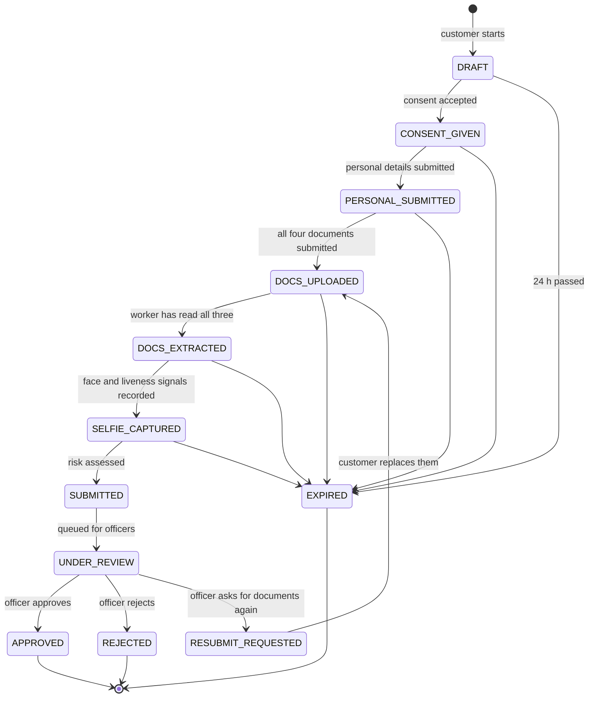

# The KYC session state machine

One application is one `kyc_sessions` row, and its `status` is the only thing that says where it stands. The whole machine is a
plain table in [`packages/shared/src/kyc-state.ts`](../packages/shared/src/kyc-state.ts): pure functions, no I/O, shared by the
API, the worker and the tests. Nothing writes a status without going through `applyTransition`, which refuses any edge not in
the table and returns the audit row that records it.

## The states

| Status               | Meaning                                                                  | Who is waiting for whom     |
| -------------------- | ------------------------------------------------------------------------ | --------------------------- |
| `DRAFT`              | Session created. Contact (mobile OTP) is verified during this state      | the customer                |
| `CONSENT_GIVEN`      | The customer accepted a specific version of the consent text             | the customer                |
| `PERSONAL_SUBMITTED` | Details typed and submitted; they are now locked                         | the customer (uploading)    |
| `DOCS_UPLOADED`      | PAN, Aadhaar front and back and a signature uploaded and submitted       | the worker (OCR)            |
| `DOCS_EXTRACTED`     | Every document has a finished extraction                                 | the selfie step (see below) |
| `SELFIE_CAPTURED`    | Face-match and liveness signals exist                                    | the worker (risk engine)    |
| `SUBMITTED`          | Risk assessed. Lasts a moment: it is persisted so the audit log shows it | the worker                  |
| `UNDER_REVIEW`       | In the officers' queue                                                   | an officer                  |
| `APPROVED`           | An officer approved. Terminal                                            | nobody                      |
| `REJECTED`           | An officer rejected, with a reason. Terminal                             | nobody                      |
| `RESUBMIT_REQUESTED` | An officer asked for specific documents again                            | the customer                |
| `EXPIRED`            | The application sat unfinished past its 24 hours. Terminal               | nobody                      |

**What is not built.** The selfie step (Phase 4: capture, face match, liveness) does not exist. The customer sees "Selfie:
coming next", and the edge `DOCS_EXTRACTED → SELFIE_CAPTURED` is fired by a development-only signal injector
(`POST /dev/sessions/:id/biometrics`, not mounted in production) that records the face-match score and liveness result a real
selfie step would. Everything after that edge is real.

## Every transition

| #   | From → to                             | Fired by                                                | Guard                                           | Actor in the audit row |
| --- | ------------------------------------- | ------------------------------------------------------- | ----------------------------------------------- | ---------------------- |
| 1   | `DRAFT → CONSENT_GIVEN`               | `POST /kyc/sessions/:id/consent`                        | contact verified                                | the customer           |
| 2   | `CONSENT_GIVEN → PERSONAL_SUBMITTED`  | `POST /kyc/sessions/:id/personal/submit`                | consent recorded; details complete              | the customer           |
| 3   | `PERSONAL_SUBMITTED → DOCS_UPLOADED`  | `POST /kyc/sessions/:id/documents/submit`               | all four document types present                 | the customer           |
| 4   | `DOCS_UPLOADED → DOCS_EXTRACTED`      | verification worker, after the last extraction finishes | none (idempotent)                               | system                 |
| 5   | `DOCS_EXTRACTED → SELFIE_CAPTURED`    | the signal injector (today), the selfie step (later)    | none                                            | the injecting officer  |
| 6   | `SELFIE_CAPTURED → SUBMITTED`         | risk job, after it records an assessment                | none                                            | system                 |
| 7   | `SUBMITTED → UNDER_REVIEW`            | the same job, as a second persisted step                | none; a retry finishes a half-done run          | system                 |
| 8   | `UNDER_REVIEW → APPROVED`             | `POST /officer/sessions/:id/decisions`                  | the officer holds the claim; compare-and-set    | the officer            |
| 9   | `UNDER_REVIEW → REJECTED`             | the same, with a reason code and a note                 | same                                            | the officer            |
| 10  | `UNDER_REVIEW → RESUBMIT_REQUESTED`   | the same, naming the document slots to reopen           | same; at most two resubmissions per application | the officer            |
| 11  | `RESUBMIT_REQUESTED → DOCS_UPLOADED`  | `POST /kyc/sessions/:id/documents/submit`               | every requested slot refilled                   | the customer           |
| 12  | `{DRAFT … SELFIE_CAPTURED} → EXPIRED` | lazily, on the next read of the session                 | `expiresAt` has passed                          | system                 |

Each of these has its own test file under [`apps/api/test/transitions/`](../apps/api/test/transitions), and a meta-test fails if
the table in `kyc-state.ts` gains an edge without one.

### Things worth knowing

- **Resubmission loops back through extraction.** After edge 11 the changed documents are read again, and if the earlier face
  and liveness signals still exist they are carried forward (an audit row says so), so the application goes `DOCS_UPLOADED →
DOCS_EXTRACTED → SELFIE_CAPTURED → SUBMITTED → UNDER_REVIEW` without the customer repeating the selfie. It re-enters the
  queue unassigned, with a fresh risk assessment (a new row; the old one stays).
- **Expiry is lazy.** There is no timer. A session past its 24 hours is marked `EXPIRED` the next time anyone reads it, with an
  audit row from the system, and the customer may then start a new application. A session at or beyond `SUBMITTED` never
  expires: it is waiting for an officer, not for the customer.
- **One active session per customer.** A partial unique index on `kyc_sessions(userId)` where the status is not terminal. A
  second `POST /kyc/sessions` returns the existing one.
- **Review claims are not states.** "Priya is looking at this" is an `officer_assignments` row, a courtesy that prevents two
  officers working the same application. What actually prevents two decisions is the compare-and-set in edge 8-10: the
  update only applies if the session is still `UNDER_REVIEW`.
- **Steps are separate from statuses.** `currentStep` (`CONTACT`, `CONSENT`, `PERSONAL`, `DOCUMENTS`, `SELFIE`, `REVIEW`) is what
  the customer's screens follow, and the server's value wins over anything the browser remembers. Verifying the mobile number
  completes the `CONTACT` step without changing the status.
- **Terminal means terminal.** Nothing leaves `APPROVED`, `REJECTED` or `EXPIRED`. A rejected customer who wants to try
  again starts a new application, and the old one stays in the record.
